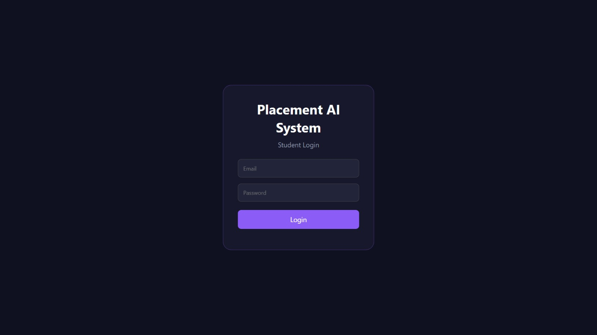
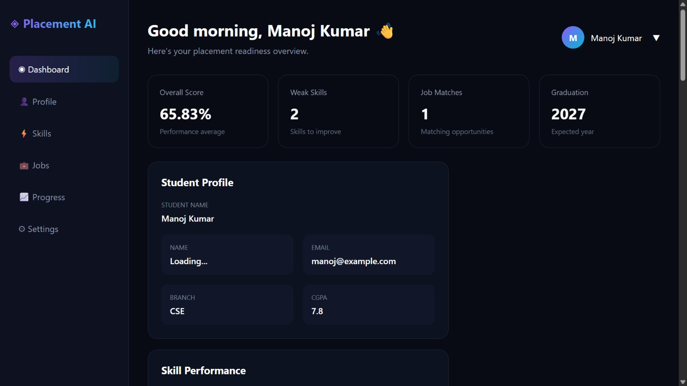
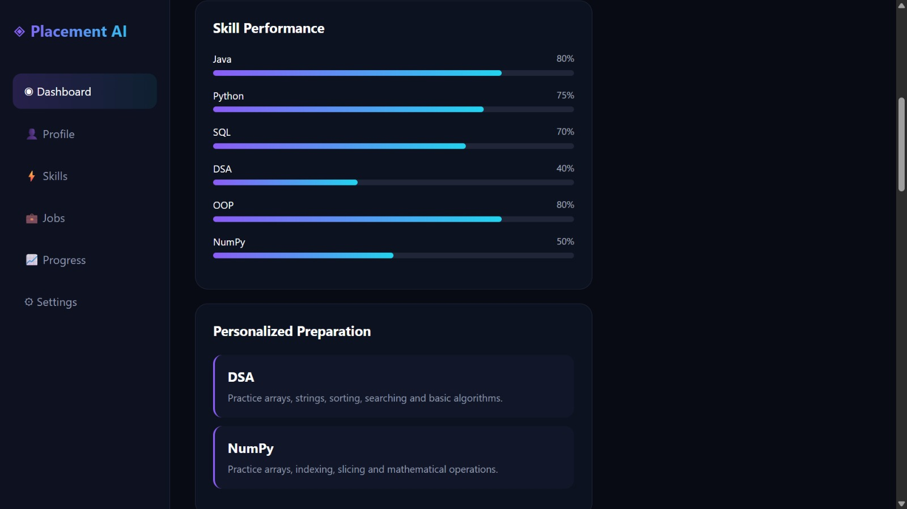
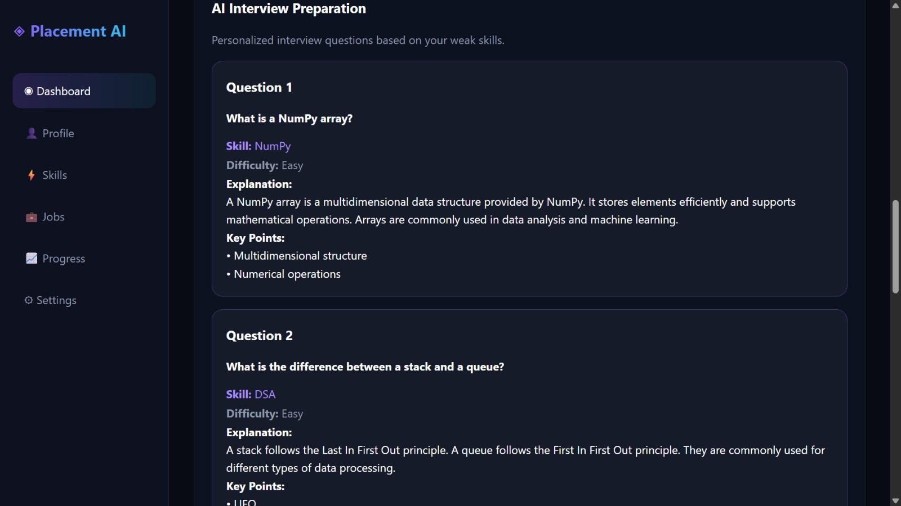
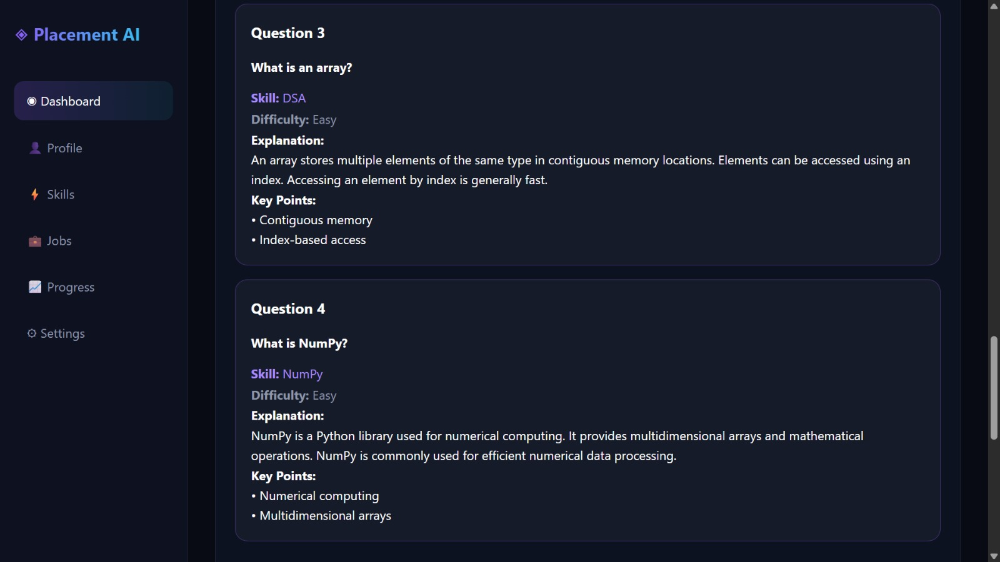
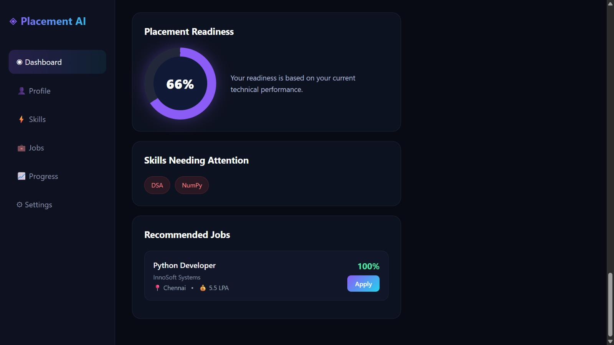

# Powered Placement & Interview Preparation System

A full-stack application designed to help students manage placement opportunities, identify skill gaps, and follow personalized interview preparation plans.

## 🚀 Features

- **Student Dashboard** – View student information and placement statistics.
- **Student Profile Management** – Manage student profiles and technical skills.
- **Job Listings** – View available job opportunities.
- **Job Eligibility Matching** – Match student skills against job requirements.
- **Skill Gap Analysis** – Identify weak technical skills using performance data.
- **Personalized Preparation Plans** – Generate preparation plans based on identified skill gaps.
- **Interview Preparation** – Access a predefined bank of interview questions.
- **Progress Analysis** – Analyze student preparation progress.

## 🛠️ Technologies Used

### Frontend
- HTML
- CSS
- JavaScript

### Java Backend
- Java
- Spring Boot
- Spring Data JPA
- REST APIs

### Python Service
- Python
- FastAPI
- Pandas
- NumPy

### Database
- MySQL

### Tools
- IntelliJ IDEA
- Visual Studio Code
- MySQL Workbench
- Postman
- Git and GitHub

## 🏗️ Project Architecture

The system consists of three main components:

1. **Frontend:** Provides the user interface for students.
2. **Java Backend:** Handles student data, job listings, eligibility matching, and database operations.
3. **Python Service:** Performs skill gap analysis and generates personalized preparation plans.

The Java backend integrates with the Python service through REST API calls.

## 📸 Screenshots

### 1. Login Page


### 2. Dashboard


### 3. Job Listings


### 4. Job Matching


### 5. Skill Gap Analysis


### 6. Interview Preparation


## 📂 Project Structure

```text
powered-placement-interview-preparation-system/
├── frontend/
│   ├── index.html
│   ├── script.js
│   └── style.css
├── backend/
│   └── Spring Boot application
├── python-service/
│   ├── main.py
│   ├── question_bank.py
│   └── requirements.txt
├── database/
│   └── schema.sql
├── screenshots/
│   ├── pas_1.jpeg
│   ├── pas_2.jpeg
│   ├── pas_3.jpeg
│   ├── pas_4.jpeg
│   ├── pas_5.jpeg
│   └── pas_6.jpeg
├── .gitignore
└── README.md

## Project Objective

The objective of this project is to simplify placement management by helping students identify suitable job opportunities, analyze skill gaps, and follow personalized interview preparation plans.

## Author

Developed as an academic project to demonstrate full-stack development, database integration, REST API communication, job matching, and data-driven skill analysis.

## Repository

[Powered Placement & Interview Preparation System on GitHub](https://github.com/24x55a0513-git/powered-placement-interview-preparation-system)

